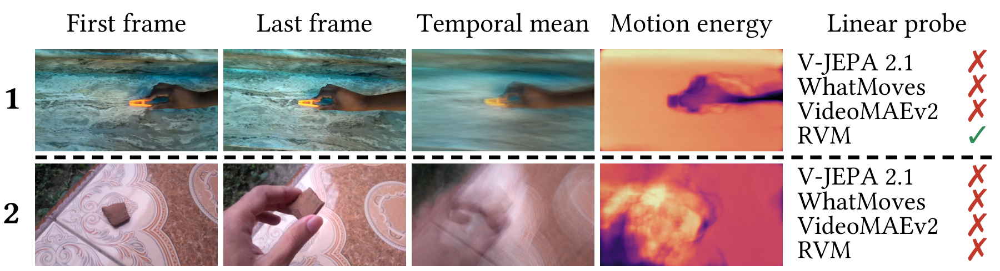
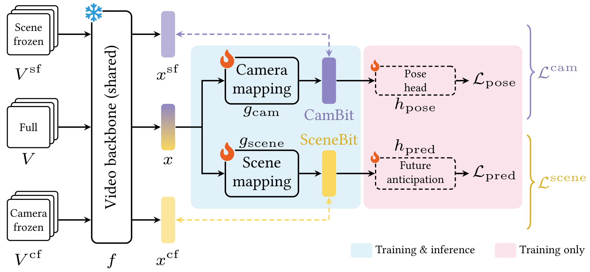

# Camera and Scene Motion Interfere with Each Other in Video Representations

**Ziqi Zhou, Laura Sevilla-Lara** · School of Informatics, University of Edinburgh


[](https://jia1018.github.io/Freeze/)


<p align="center">
  
</p>

Real-world videos often contain both camera motion and scene motion, and video foundation models encode the two jointly. We ask whether the two motions interfere with each other in these representations, and whether the interference can be reduced post hoc.

- **Freeze** is a synthetic benchmark of video triplets: the original clip, the same clip with the **camera frozen**, and the same clip with the **scene frozen**. It has an object subset (Freeze-Object, rendered physics scenes) and a human subset (Freeze-Human). All four video foundation models we test do better on every camera and scene task once the other motion is frozen, so the interference goes both ways.
- **CamBit** and **SceneBit** are two lightweight mappings learned on top of fixed backbone features. They bring a clip's features closer to its scene-frozen and camera-frozen versions. CamBit improves camera understanding and geometric grounding on real videos for nearly every task and backbone; SceneBit improves the scene tasks of Freeze and those on real videos, with a context-dependent effect.

<p align="center">
  
</p>

## Citation

```bibtex
@inproceedings{zhou_freeze,
  title     = {Camera and Scene Motion Interfere with Each Other in Video Representations},
  author    = {Zhou, Ziqi and Sevilla-Lara, Laura},
  booktitle = {TBD},
  year      = {TBD}
}
```

## Acknowledgements

The project page is based on the [Nerfies](https://github.com/nerfies/nerfies.github.io) template.
